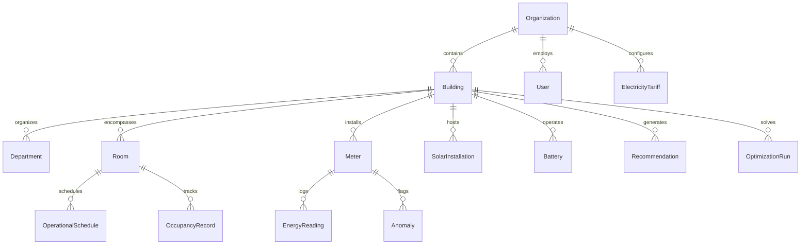

# EcoGrid Database Specification & Schema Design

EcoGrid uses Prisma ORM with relational schema isolation.

## Entity Relational Diagram

## Key Relational Models

1. **`Organization`**: Multi-tenant root. Holds organization profile, industry vertical (`HIGHER_EDUCATION`, `MANUFACTURING`, etc.), timezone, and currency.
2. **`Building`**: Physical facility with square footage, building category, and meter links.
3. **`Room`**: Spatial allocation (classroom, laboratory, auditorium) with expected operating windows.
4. **`EnergyReading`**: Time-series meter telemetry storing interval consumption (kWh) and power demand (kW).
5. **`OperationalSchedule`**: Timetable records with days of the week, start/end times, activity types, and scheduled student occupancy.
6. **`ElectricityTariff` & `TariffPeriod`**: Granular Time-of-Use pricing tiers (Off-Peak, Standard, Peak Demand).
7. **`SolarInstallation` & `SolarReading`**: Photovoltaic generation telemetry and peak array ratings.
8. **`Battery` & `BatteryReading`**: Electrochemical storage capacities, charge/discharge power limits, SOC percentages, round-trip efficiencies, and cycling degradation costs.
9. **`Anomaly`**: Outlier records classifying spikes, unscheduled surges, and high idle-period drains with workflow resolution status.
10. **`Recommendation`**: Actionable operational interventions backed by telemetry evidence and projected financial impact.
11. **`OptimizationRun`**: Mathematical linear programming results storing baseline vs optimized operating costs and savings.
12. **`Scenario`**: Campus digital twin hypothetical simulations kept strictly isolated from real meter telemetry.
